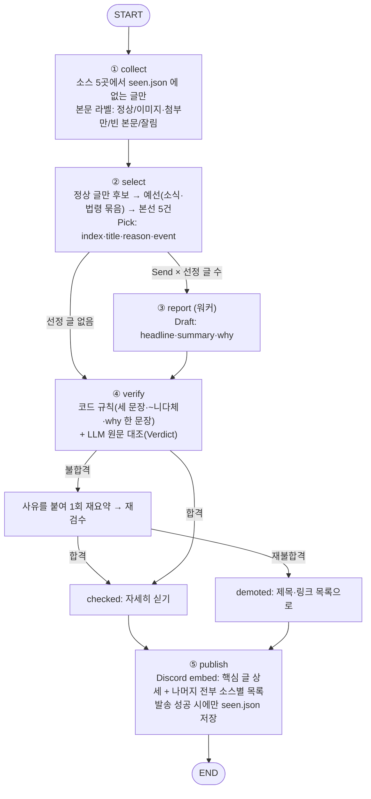
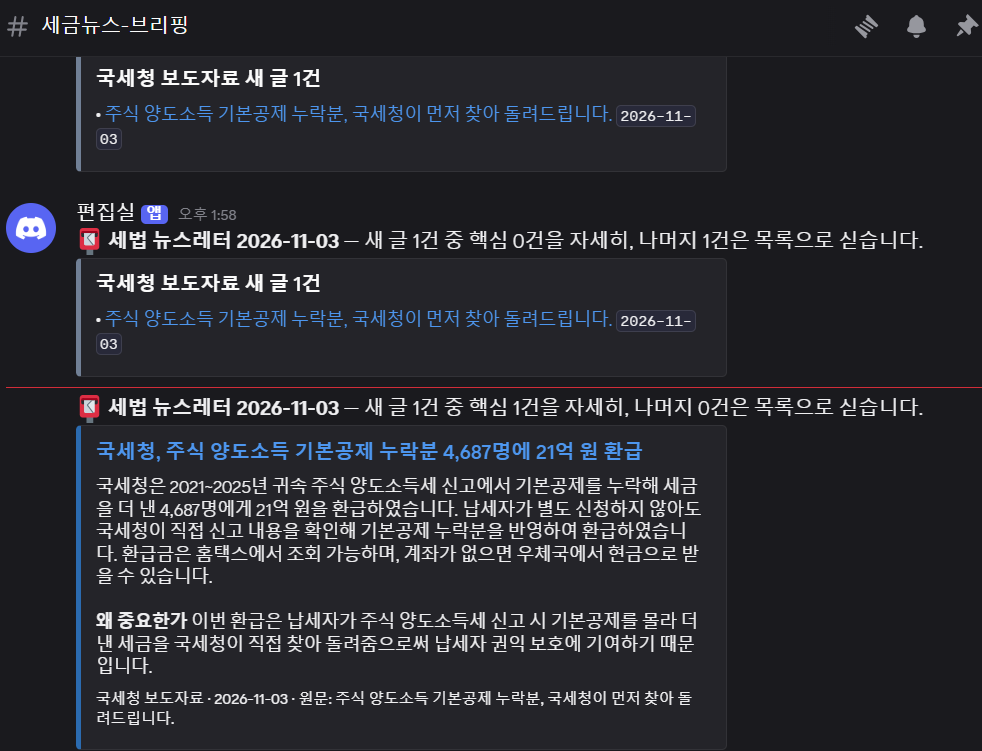

# 세법 뉴스레터 에이전트 — REPORT

국세청·홈택스·국세법령정보시스템에 새로 올라온 글을 매일 모아, 핵심 5건은 요약과 함께 자세히 싣고 나머지 새 글은 전부 제목·링크로 실어 Discord로 보내는 LangGraph 에이전트입니다.

- 실행: `python run.py` (기본 `DRY_RUN=1`, 실제 발송은 `DRY_RUN=0`)
- 자동 실행: [.github/workflows/daily.yml](.github/workflows/daily.yml) — 매일 12:00(KST), 수동 실행 가능
- 모델: OpenAI `gpt-4.1-mini`, `temperature=0`

## 1. 분야 및 독자 정의

**분야: 세법(세무) 새 소식.**
세법 관련 새 소식은 국세청 보도자료, 국세청 공지사항, 홈택스 공지사항, 국세법령정보시스템(판례·개정법령)에 흩어져 있습니다. 신고·납부·신청 기한이나 서비스 변경처럼 바로 챙겨야 하는 글이 많아, 매일 한곳에 모아 볼 필요가 있습니다.

**독자: 세금에 관심 있는 누구나, 특히 사업자와 세무사무실.** ([audience.yaml](audience.yaml))

- 사업자: 자기가 해당하는 기한, 지원 제도, 서비스 변경을 놓치지 않아야 합니다.
- 세무사무실: 고객에게 안내할 제도 변경과 홈택스 변경 사항, 실무에 영향을 주는 판례·개정법령을 빠짐없이 봐야 합니다.

그래서 이 뉴스레터는 **모든 새 글을 싣습니다.** 선별은 버릴 글을 고르는 일이 아니라, 자세히 다룰 핵심 글을 고르는 일입니다.

## 2. 소스 채택표

후보 6곳을 [measure_sources.py](measure_sources.py)로 측정했습니다. 소스마다 최신 글 10건을 받아 글마다 본문 상태 라벨을 붙였습니다. 결과는 [store/source_measure.json](store/source_measure.json)에 있습니다(측정 2026-11-02 22:06).

**판정 기준 (측정 전에 정함)**

1. 목록 요청 응답이 200일 것
2. 본문 확보: 최신 10건 중 `정상` 라벨이 1건 이상일 것

**본문 상태 라벨**

| 라벨 | 뜻 |
| --- | --- |
| 정상 | 본문 칸을 찾았고 글자가 있음 |
| 이미지·첨부만 | 본문 칸은 있지만 글자가 30자 미만이고 이미지나 첨부파일만 있음 |
| 빈 본문 | 본문 칸은 있지만 글자도 이미지도 없음 |
| 잘림 | 본문 칸이나 본문 요청을 찾지 못함(수집 실패) |

**측정 결과**

| 소스 | 응답 | 전체 글 | 최신 글 | 본문 상태(10건) | 정상 글 길이 | 원문 링크 | 판정 |
| --- | --- | --- | --- | --- | --- | --- | --- |
| 국세청 보도자료 | 200 | 3,314 | 11-02 | 정상 10 | 1,803~10,505자 | 열림 | **채택** |
| 국세청 공지사항 | 200 | 714 | 10-30 | 정상 10 | 71~4,403자 | 열림 | **채택** |
| 홈택스 공지사항 | 200 | 115 | 10-07 | 정상 3 · 이미지·첨부만 7 | 199~1,428자 | 글마다 주소 없음 | **채택** |
| 국세법령정보시스템 판례·결정례 | 200 | 156,469 | 11-02 | 정상 10 | 1,818~24,905자 | 열림 | **채택** |
| 국세법령정보시스템 최신개정법령 | 200 | 6,567 | 10-02 | 정상 10 | 387~5,537자 | 열림 | **채택** |
| 기획재정부 세제실 | 200 | 2,274 | 10-30 | 이미지·첨부만 10 | — | 열림 | **탈락** |

- **기획재정부 세제실 탈락 이유:** 웹 본문 칸(`editorCont`)에는 에디터 스크립트만 있고, 내용은 첨부파일(hwpx·pdf)에만 있습니다. 10건 모두 `이미지·첨부만`이라 본문을 확보할 수 없습니다.
- **홈택스 채택 이유:** 10건 중 7건이 이미지·첨부만이지만, 정상 글이 3건 있어 기준 2를 통과합니다. 이미지·첨부만인 글은 요약 후보에서 빼고 목록에만 싣습니다(3절).
- **교안의 본문 길이 기준(600자)은 쓰지 않았습니다.** 교안의 600자는 RSS 요약만 받았거나 원문 추출이 잘렸는지 가리는 값입니다. 세법 공지는 원래 짧은 글이 많고(국세청 공지사항 최소 71자), 짧아도 중요할 수 있습니다. 대신 "잘렸는지"는 본문 칸을 찾았는지로 판단합니다(`잘림` 라벨). 30자는 길이로 거르는 값이 아니라 "글자가 없다"를 가리는 값입니다.
- **최근 게시 여부는 판정 기준으로 쓰지 않았습니다.** 기관 게시판은 며칠씩 글이 없는 날이 있어 최근성으로 소스를 거르면 안 됩니다. 최신 글 날짜는 측정 데이터로만 실었습니다.
- **해외 서버 접속:** 정부 사이트는 해외 접속을 막는 경우가 있어, [access-test.yml](.github/workflows/access-test.yml)로 GitHub 서버에서 접속을 확인했습니다. 4개 사이트 모두 200이었습니다.

## 3. 선별 로직 설계

### 중요도 판단 문장 ([audience.yaml](audience.yaml))

- 어려운 세법 해설이나 판례보다, 공지사항·보도자료처럼 새로 나온 소식을 메인으로 다룬다.
- 사업자나 세무사무실이 바로 알고 챙겨야 하는 소식(신고·납부·신청 기한, 제도 변경, 서비스 변경)을 앞에 둔다.
- 자세히 다루지 않을 것: 기관 관련 소식(국세청의 수상·성과 홍보, 기관 행사·공모전, 인사, 조직 소식)

### 2단계 구조

```
수집한 새 글
 └ 요약 후보: 본문 상태가 '정상'인 글만 (이미지·첨부만·빈 본문·잘림은 목록에만)
    ├ 예선 '소식' 묶음 (국세청 보도자료·공지사항, 홈택스) → 최대 5건
    └ 예선 '법령' 묶음 (판례·결정례, 최신개정법령)       → 최대 5건
       └ 본선: 예선 통과 글을 합쳐 5건 (같은 event 라벨은 건너뛰고 다음 순위로)
```

- **묶음은 건수가 아니라 소스 종류로 나눴습니다.** 이 분야는 하루 새 글이 10건 안팎이라 교안의 40건 묶음은 거의 작동하지 않습니다. 또 한 묶음에 다 넣으면 건수가 많은 판례(첫 실행 20건)가 소식을 덮습니다. "새 소식이 메인"이라는 기준을 구조에도 반영하려고 소스 종류로 나눴습니다.
- **묶음 안이 5건 이하이면 LLM을 부르지 않고 전부 통과**시킵니다. 본선도 5건 이하이면 전부 선정합니다.
- **본선은 `target+3`(8건)을 받습니다.** 같은 사건을 다룬 글(같은 `event` 라벨)을 건너뛰어도 5건을 채울 수 있게 하기 위해서입니다.
- **요약 후보를 `정상` 글로 제한한 이유:** 이미지·첨부만 있는 글을 요약시키면 제목만 보고 내용을 지어냅니다. 이미지를 모델에 읽히는 방식은 쓰지 않았습니다. 쓰면 기획재정부를 탈락시킨 근거(웹 본문 없음)와 어긋나기 때문입니다.
- **번호 혼동 보정:** 모델이 고른 번호와 적은 이유가 서로 다른 글을 가리키는 일이 있었습니다(홈택스 서식 공지에 상증세법 시행령 사유가 붙음). 그래서 고른 글의 제목도 함께 받아, 번호와 제목이 어긋나면 제목으로 바로잡습니다.

### 선별 근거 (첫 실제 발송, 2026-11-03 10:04, [store/metrics.jsonl](store/metrics.jsonl) 1행)

```
① 수집   새 글 80건 — 보도자료 10, 공지사항 10, 홈택스 20, 판례·결정례 20, 최신개정법령 20
         본문 상태: 정상 65 · 이미지·첨부만 12 · 빈 본문 3 · 잘림 0
② 선별   요약 대상 아님(본문 글자 없음, 목록에는 실림) 15건 → 예선 소식 25→5, 법령 40→5 → 본선 10→5
```

| 선정 글 | event 라벨 | 선정 이유(모델) |
| --- | --- | --- |
| [보도자료] 5월에 놓친 근로·자녀장려금, 12.1.까지 '꼭' 신청 | 근로·자녀장려금 신청 마감 | 신청 마감 기한이 임박해 반드시 챙겨야 함 |
| [보도자료] 글로벌최저한세, 세무전문가들과 함께 두 번째 신고를 준비하다! | 글로벌최저한세 신고 준비 | 신고 준비에 참고할 정보 |
| [보도자료] 고용·투자 늘린 중소기업, 세무조사 부담 없앤다 | 중소기업 세무조사 부담 완화 | 사업자에게 직접 영향을 주는 제도 변경 |
| [공지사항] 일자리창출기업에 대한 세정지원 안내 | 일자리창출기업 세정지원 | 해당 기업이 챙겨야 할 지원 제도 |
| [공지사항] 투자확대기업에 대한 세정지원 안내 | 투자확대기업 세정지원 | 관련 기업이 알아야 할 지원 소식 |

- 5건 모두 소식 묶음에서 나왔습니다. 법령 묶음 5건은 예선을 통과했지만 본선에서 밀렸습니다. "새 소식이 메인"이라는 기준대로 동작한 결과입니다.
- 같은 세정지원 제도를 다룬 보도자료 1건과 공지사항 2건은 서로 다른 event 라벨을 받았습니다. 보도자료는 정기 세무조사 선정 제외를 다루고, 공지사항 2건은 각각 일자리창출기업과 투자확대기업에 대한 세정지원을 안내합니다. 내용 범위가 달라 중복으로 보지 않았습니다.
- 두 번째 실행(같은 날 DRY_RUN): `새 글 0건 (지난번까지 본 글 80건 제외)`로, 이미 보낸 글은 다시 오지 않았습니다(metrics.jsonl 2행).

## 4. 파이프라인 구조도



**State (`Brief`)**

| 칸 | 채우는 노드 | 내용 |
| --- | --- | --- |
| `seen` | run.py | 지난번까지 보낸 글 번호(`store/seen.json`) |
| `collected` | ① collect | 새 글 전부. 전부 발행된다 |
| `picked` | ② select | 자세히 다룰 글. `event`·`pick_reason` 붙음 |
| `drafted` | ③ report | 초안. 워커들이 나눠 채운다(리듀서 `operator.add`) |
| `checked` · `demoted` | ④ verify | 합격 / 재요약 뒤에도 불합격 |
| `sent` | ⑤ publish | 발송 완료 / DRY_RUN / 발송 실패 |
| `log` | 모든 노드 | 실행 기록(리듀서) |

**예외 처리**

| 상황 | 대응 |
| --- | --- |
| 소스 하나가 응답 없음 | 그 소스만 "응답 없음"으로 로그에 남기고 나머지는 계속 |
| 본문 요청 실패 | 1초 뒤 1회 재시도, 또 실패하면 그 글만 `잘림`(목록에만 실림) |
| 받은 목록이 전부 새 글 | "목록 밖에 더 있을 수 있음" 경고 |
| 요약(③) 한 건 실패 | 그 글은 목록으로 싣고 나머지 워커는 계속. 로그에 오류 메시지와 원래 원인을 남김(키·웹훅 주소는 가림) |
| 검수 불합격 | 사유를 알려 주고 1회 재요약 → 재불합격이면 목록으로 내림(빼지 않음) |
| 검수 호출 자체가 실패 | 확인 안 된 요약이므로 목록으로 내림 |
| 새 글 0건 | "오늘은 새 글이 없습니다" 메시지 |
| Discord 429 | 알려 준 시간만큼 쉬고 1회 재시도 |
| Discord 발송 실패 | `seen.json`을 저장하지 않음 → 다음 실행에서 같은 글을 다시 받음. Actions는 실패로 표시 |
| Discord 글자 제한 | embed 설명 3,800자, 메시지당 embed 10개·글자 합 5,800자로 나눠 보냄 |

**검수 동작 확인:** 일부러 틀린 초안(마감일 12월 31일, 원문에 없는 1인당 300만원, "~다"체, why 두 문장)을 넣어 시험했습니다. 코드 규칙 3건과 LLM 대조 2건(마감일이 원문과 다름, 금액이 원문에 없음)을 모두 잡았고, 재요약본은 원문대로 고쳐져 합격했습니다. 첫 실제 발송에서는 5건 모두 처음부터 합격했습니다.

## 5. 실행 기록

과제 제출용 실행은 GitHub Actions에서 **수동 실행(`workflow_dispatch`)** 했습니다. 평소에는 [daily.yml](.github/workflows/daily.yml)의 예약(매일 12:00 KST)으로 같은 작업이 돕니다.

### 2026-11-03 14:04 — GitHub Actions 수동 실행 ([실행 기록](https://github.com/ctaleez51-art/my-newsletter/actions/runs/41581655065), [store/metrics.jsonl](store/metrics.jsonl) 5행)

```
① 수집   새 글 1건 (지난번까지 본 글 80건 제외)
   국세청 보도자료: 목록 10건 중 새 글 1건 (정상 1)
   국세청 공지사항: 목록 10건 중 새 글 0건
   홈택스 공지사항: 목록 17건 중 새 글 0건
   판례·결정례: 목록 20건 중 새 글 0건
   최신개정법령: 목록 20건 중 새 글 0건
② 선별   1 → 예선 1 → 1건
③ 취재   [국세청 보도자료] 국세청, 주식 양도소득 기본공제 누락분 4,687명에 21억 원 환급
④ 검수   1건 → 합격 1 · 목록으로 내림 0
⑤ 발행   핵심 1건 + 목록, 메시지 1개 — 발송 완료, seen.json 81건 저장
```

GitHub 서버에서 수집(국세청·홈택스·국세법령정보시스템), 요약·검수(OpenAI), Discord 발송, `seen.json`·`metrics.jsonl` 재커밋까지 모두 동작했습니다.

Discord 화면 (맨 아래가 이 실행, 위 두 메시지는 아래 실패 기록):



### 앞선 두 번의 실패

| 실행 | 결과 | 로그에 남은 원인 | 대응 |
| --- | --- | --- | --- |
| [13:46](https://github.com/ctaleez51-art/my-newsletter/actions/runs/41580023681) | 요약 실패 → 그 글을 목록으로 발송 | `APIConnectionError` (오류 이름뿐이라 원인을 알 수 없음) | 오류 메시지와 원래 원인까지 남기도록 고침. 키·웹훅 주소는 `***`로 가림 |
| [13:58](https://github.com/ctaleez51-art/my-newsletter/actions/runs/41581124239) | 요약 실패 → 그 글을 목록으로 발송 | `APIConnectionError ← LocalProtocolError: Illegal header value` | GitHub Secret `OPENAI_API_KEY` 값에 키에 들어갈 수 없는 글자가 섞여 있었음. Secret을 다시 등록 |

- 두 번 모두 요약은 실패했지만, 글은 버려지지 않고 목록으로 발송됐습니다(4절 예외 처리).
- 같은 글로 다시 시험하려고 실행 전에 `seen.json`에서 그 글 번호를 뺐습니다. 그래서 같은 글이 세 번 발송됐습니다.

### 첫 실제 발송

2026-11-03 10:04 로컬 실행 — 새 글 80건, 핵심 5건, 메시지 3개, 검수 5건 합격. 3절 선별 근거는 이 실행 기록입니다([store/metrics.jsonl](store/metrics.jsonl) 1행).

## 6. 프로젝트 회고

### 가장 공들인 부분

- **소스를 측정한 뒤에 고른 것.** 후보마다 실제 요청을 만들어 글 10건씩 받아 보고, 본문 상태 라벨로 채택·탈락을 정했습니다. 기획재정부는 목록은 잘 열리지만 본문이 첨부에만 있어, 측정하지 않았다면 채택했을 소스였습니다.
- **"새 글"을 시각이 아니라 글 번호로 판단한 것.** 몇 시에 실행하든, 하루를 건너뛰든 겹치거나 빠지는 글이 없습니다. `seen.json`은 발송에 성공한 뒤에만 저장하므로, 발송이 실패한 날의 글은 다음 실행에서 다시 들어옵니다.
- **선별에서 떨어진 글도 버리지 않은 것.** 이 독자에게는 모든 새 글이 의미가 있어, 핵심은 자세히, 나머지는 목록으로 싣고, 검수에 떨어진 글도 목록으로 내렸습니다.

### 향후 개선점

- **헤드라인 길이:** `Draft`에 "20자 내외"라고 했지만 실제로는 30~40자가 나옵니다. 코드 규칙에 넣지 않아 검수에 걸리지 않습니다.
- **이미지·첨부만 있는 글:** 홈택스 공지의 절반 이상이 이미지라 요약 후보가 되지 못합니다. 첨부(hwp·pdf)나 이미지에서 글자를 뽑는 단계를 넣으면 홈택스와 기획재정부도 요약할 수 있습니다.
- **홈택스 원문 링크:** 홈택스는 글마다 주소가 없어 공지사항 목록 주소로 연결됩니다.
- **법령 묶음의 비중:** 소식이 5건 이상인 날은 판례·개정법령이 본선에서 거의 밀립니다. 법령 몫을 1~2건 따로 두는 방법을 검토할 수 있습니다.
- **검수 기록:** 첫 발송에서는 재요약이 한 건도 일어나지 않았습니다. 실행이 쌓이면 metrics.jsonl의 `verify_demoted`·`demoted_reasons`로 불합격 경향을 볼 수 있습니다.
